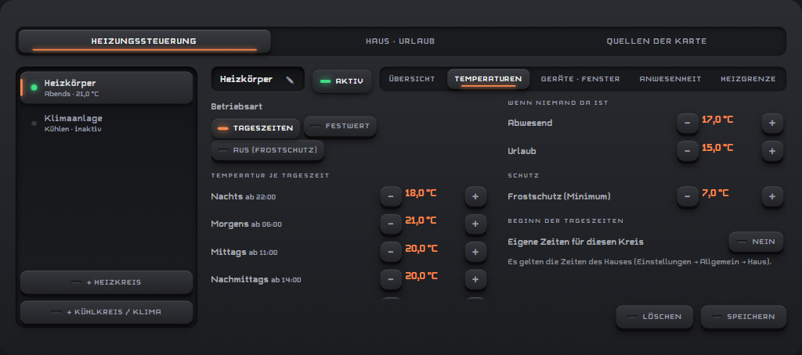
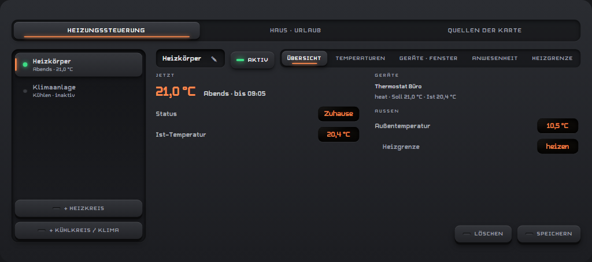

# Heat Control

Heating and cooling control for Home Assistant with circuits per room. A circuit is one or more `climate` devices sharing one set of temperatures; heating circuits (thermostats) and cooling circuits (air conditioners, optionally a heat pump) run separately.


*Heating tab in the [Room Panel card](https://github.com/SysriX/room_panel_ha_card): temperatures per time of day, away / vacation and frost protection for a heating circuit (UI in German)*


*Overview of a heating circuit: current target, status, devices and outdoor temperature / heating limit (UI in German)*

Integration domain: `heat_control`  
Version: 1.0.0  
UI language of the built-in texts (status, reasons): German

> Built for the author's own home. It works with any `climate` entities; some defaults and the first-start seeding use entity naming conventions of the author's setup (see [Optional helper entities](#optional-helper-entities)). Room ids may need adapting.

## Features

- Up to 8 circuits per room, each with its own temperatures for the day periods (morning, midday, afternoon, evening, night), a fixed value, away, vacation and frost protection.
- **House status**: home / away (after a delay) / vacation / return (pre-heating before the end of a vacation). Presence and alarm panel can be combined with *or* / *and*. Vacation by switch with optional start/end, by the alarm mode `armed_vacation`, or after being away for X hours.
- **Modes per circuit**: schedule (day periods), fixed value, off.
- **Locks**: open windows (with delay, tilted counts as open), heating limit by outdoor temperature (current value or average over 1 day / 1 week / 1 month / 1 year from recorder statistics), heat pump heating, air conditioner cooling → frost protection or AC off.
- **Cooling circuits**: cooling limits, optional heat pump role (`heat_by`: thermostats, heat pump or both below an outdoor temperature), follow comfort values of a heating circuit, away behaviour.
- **Manual override**: if someone changes the setpoint on the device/dashboard, it is kept until the next day period, a status change or for X hours (configurable).
- **Room sensor compensation**: optionally corrects the setpoint by the difference between thermostat and room sensor.
- **Radio-friendly sending**: only on deviation, at most one command per device per minute, with confirmation and retries.
- Setpoint changes fire the event `heat_control_changed`.

## Entities

| Entity | Description |
| --- | --- |
| `sensor.<room>_heat_control` | Target temperature (°C) of the first active heating circuit; attribute `circuits` = all circuits with their state |
| `sensor.haus_heat_control` | House status `home` / `away` / `vacation` / `return`; attributes: settings, sources, outdoor averages |

## Services

| Service | Description |
| --- | --- |
| `heat_control.set_vacation` | Set the house-wide vacation switch (`enabled`, optional `from`, `to`) |
| `heat_control.set_enabled` | Enable or disable a circuit (`circuit_id`, `enabled`) |
| `heat_control.reset_manual` | Clear a manual setpoint; the circuit follows the plan again (`circuit_id`) |

Circuit IDs are in the `circuits` attribute of `sensor.<room>_heat_control`. A WebSocket API (`heat_control/save`, `delete`, `house`, `averages`, `reset_manual`) is used by the companion card.

## Requirements

- Home Assistant 2024.6 or newer
- `climate` entities; `recorder` for the outdoor temperature averages
- Recommended: the companion card for configuration (there is no config flow / options UI)

## Installation

### HACS (custom repository)

1. HACS → three-dot menu → **Custom repositories**
2. Repository `https://github.com/SysriX/heat_control_ha_integration`, category **Integration**
3. Install **Heat Control** and restart Home Assistant

### Manual

Copy `custom_components/heat_control` into `<config>/custom_components/` and restart Home Assistant.

## Configuration

YAML only (no config flow). Add to `configuration.yaml` and restart:

```yaml
heat_control:
  rooms: [wz, bu, ku, sz, fl, ke, ba, bz]   # optional, this is the default
```

`rooms` is a list of short room ids (slugs); one sensor is created per room. The defaults are the author's German room abbreviations – use your own. Settings and circuits are stored in `.storage/heat_control`. New circuits are created disabled. Set the house-wide outdoor temperature sensor in the card (empty by default).

### Optional helper entities

| Entity | Purpose |
| --- | --- |
| `input_text.haus_light_motion_cfg_presence_sensor` | Presence source (value = entity id); falls back to `zone.home` |
| `input_text.haus_light_motion_cfg_alarm_panel` | Alarm panel entity (value = entity id) |
| `input_datetime.haus_sys_daytime_cfg_<morning\|midday\|afternoon\|evening\|night>_start` | House-wide start times of the day periods; defaults 06:00 / 11:00 / 14:00 / 18:00 / 22:00 |
| `climate.<room>_heater_grp` | First start only: a disabled heating circuit is created for each room where this entity exists |
| `input_text.heizung_sensoren_<room>` | First start only: `current=<sensor>` is used as the circuit's room sensor |

## Companion card

[room_panel_ha_card](https://github.com/SysriX/room_panel_ha_card) (`custom:raum-panel`) – settings → heating control.

## License

MIT – see [LICENSE](LICENSE).
